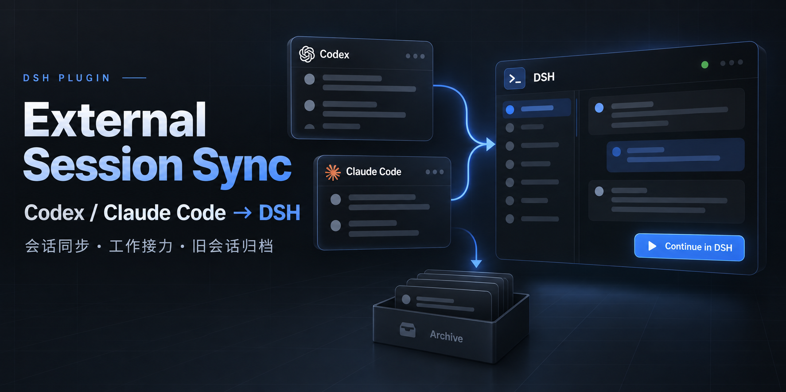

# dsh-plugin-external-session-sync

A standard DSH (DeepSeek Harness) plugin bundle that imports **Codex** and **Claude Code** conversation history into **native DSH sessions**, verifies that each imported chat is registered in its project, and lets you continue the work inside DSH. It also ships **bulk archival** for old sessions.

> DSH plugin, not a standalone app. It runs inside a DSH profile: one Host row (routes + agent tools) and one browser bundle (the panel and the sidebar actions).

## Features

- **One import list for both sources.** Codex rollouts and Claude Code JSONL are read directly, read-only.
- **Complete Codex history.** A single Codex thread is often split across many `rollout-*.jsonl` files; the reader merges every segment of the thread and sorts by timestamp, so an import contains the newest turns instead of only the first rollout.
- **Uses Codex's own thread index.** Discovery reads `state_5.sqlite` so archived and continuation threads are not silently dropped, and it also finds a rollout that exists on disk before Codex indexes it.
- **Native imports only.** Each chat is created through DSH's Session, Session Persistence, Session Controller and Workspace Registry APIs. No hand-written session log, no edited workspace index.
- **Verified project membership.** "Synced" means the body is readable, the **original session id** resumed, and the chat is registered in its project. Re-running sync repairs a missing registration without rewriting history.
- **Work handoff.** From the panel you can open the imported native session and keep working in it with DSH's own composer.
- **Idempotent snapshots.** Same source revision → skip. New source revision → a new native session, so a chat you already continued is never overwritten.
- **Bulk archival.** Archive old sessions by age (1 / 3 / 6 / 12 months), pinned sessions are never archived, and a project whose members are all archived can be unregistered so the sidebar has no empty projects. Chat bodies, session logs and directories are kept.
- **Agent tools.** `codex_sync_status`, `codex_sync_import`, `codex_read_conversation`.

## Install

Install the directory as a DSH bundle (Plugin Manager → install bundle from a local package directory), or add the row by hand to your profile patch:

```yaml
- insert:
    - id: external-session-sync-native
      name: dsh-plugin-external-session-sync
```

Requirements: DSH with the Web client, Node.js 22.5+ (the readers use the built-in `node:sqlite`, and degrade to filesystem-only discovery when it is unavailable).

## Use

1. Click **Codex 同步 / External Sync** in the left sidebar, or **会话同步** in a chat header.
2. Pick **Codex** or **Claude**, search by title or project directory.
3. **同步所选** imports the selected conversation, **同步全部** imports every normal conversation of that source.
4. The result line reports `新增 / 已同步 / 修复项目关联 / 失败`.
5. **在 DSH 继续** opens the imported native session and hands the work over to DSH.

Archive buttons:

- Panel row: month selector (**1 month** by default) + **归档旧会话** — archives synced conversations of the current source.
- Sidebar footer: **旧会话归档** — archives **native DSH sessions only**, older than 1 month, with a confirmation dialog.

## Where data lives

| Path | Purpose |
| --- | --- |
| `$DSH_HOME/storages/external-session-sync-v1.json` | external id → native session id map |
| `$DSH_HOME/external-session-sync/archives/<session-id>.json` | plain-text archive of the imported messages |
| `$DSH_HOME/external-session-sync/runtime.log` | runtime log |

Source history is never modified: `.codex/` and `.claude/` are opened read-only.

## What is imported

Visible user and assistant text, title, and working directory. Tool calls, hidden reasoning and binary attachments are **not** replayed as actions. Only text is imported, so a chat with paths or secrets inside its transcript carries that text with it — remember that when you publish or share a synced profile.

## Security notes

- HTTP routes are bound to the local DSH web server and reject non-loopback `Origin`s and POSTs without the `x-dsh-sync` header.
- The plugin never stores credentials. It does not read provider configuration.
- Archiving uses DSH's registry, so it is reversible with `workspaceRegistry.unarchiveSession`.
- `deleteEmptyWorkspaces` only runs after a real archive in the same request; an empty request can never unregister projects.

## Session format compatibility

DSH records the first surface event of a session as its **protected system head** and rejects
any later `system/message` when no head was recorded
(`system/message requires a protected first surface head`). Continuing an imported chat makes
the runtime append its own system message, so an import that starts with a user message
corrupts the log on the first continued turn.

Imports therefore open with `turn/start -> step/start -> system/message` (role `system`,
source `system-prompt`, carrying an id) and only then the transcript.

`POST /external-session-sync/self-check` runs the generated shape through DSH's own session
validator, once as written and once with the appended runtime system message, so a profile
upgrade cannot silently break imports.

Sessions imported by versions before 1.0.2 lack that head and can still corrupt when continued.

### Migrating older imports

`GET /external-session-sync/legacy-imports` lists every mapping whose log has no protected
head, split into re-importable and no-longer-recoverable ones. `POST
/external-session-sync/migrate-heads` archives the old session and re-imports the same source
conversation under a new identity, in batches:

```bash
curl -s -XPOST -H 'x-dsh-sync: 1' -H 'content-type: application/json' \
  -d '{"dryRun":true}' http://127.0.0.1:<port>/external-session-sync/migrate-heads
curl -s -XPOST -H 'x-dsh-sync: 1' -H 'content-type: application/json' \
  -d '{"dryRun":false,"limit":30}' http://127.0.0.1:<port>/external-session-sync/migrate-heads
```

Repeat until `remaining` reaches 0 or a batch reports no progress. Mappings whose source
history is gone are never touched. Archiving is reversible with
`workspaceRegistry.unarchiveSession(oldSessionId)`, and each run appends a rollback journal at
`$DSH_HOME/external-session-sync/migration-<timestamp>.json`.

## Known limitations

- Codex `state_5.sqlite` may lag behind the newest rollout; discovery compensates by scanning rollouts, but a thread whose files are all gone cannot be imported.
- A conversation whose original working directory no longer exists is imported into the plugin checkout's parent directory and flagged with a warning.
- Imported sessions are snapshots: continuing inside DSH does not write back to Codex or Claude Code.
- Codex reasoning items and tool payloads are intentionally dropped.

## Tests

```bash
node --test test/
```

The suite covers thread-index discovery, multi-rollout merging, snapshot stability, missing-project repair, idempotent re-sync, dry runs, attachment failures, and the panel/footer archive selection logic. It uses temporary fixtures only — no personal data.

## 中文速览

这是一个标准 DSH 插件包：把 Codex / Claude Code 的历史会话导入为 DSH 原生会话，校验项目归属后可继续对话，并支持按时间批量归档旧会话。

- 左侧「Codex 同步」打开同步页；聊天标题旁「会话同步」打开右侧上下文面板。
- 同步完成需同时满足：正文可读、原会话 id 恢复成功、已登记到对应项目。
- 同一版本重复同步会跳过；源会话更新则创建新快照，保护你已经接手过的会话。
- 右侧面板可选择 1 / 3 / 6 / 12 个月并「归档旧会话」；左下角「旧会话归档」只作用于 DSH 原生会话。
- 置顶会话永不归档；归档保留正文与文件；某项目成员全部归档后会移除该空项目注册。
- 只导入可见的用户/助手文本，不回放工具调用与隐藏推理，也不修改 `.codex` / `.claude` 原始文件。

MIT License.
